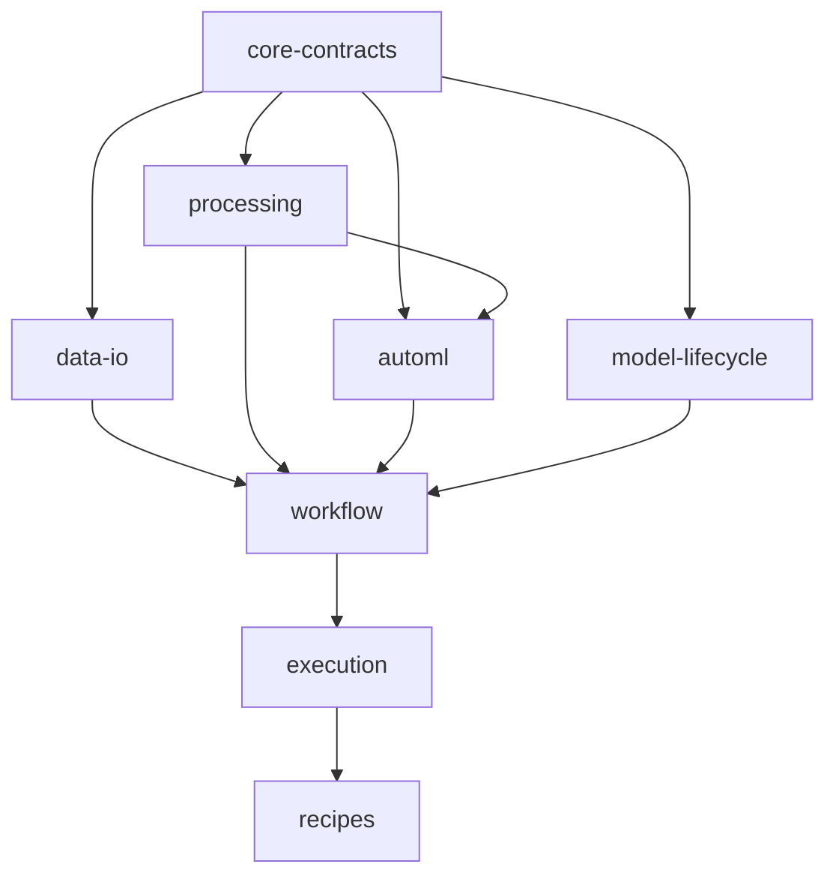

# Implementation Plan: Generic Data and Machine Learning Library

Updated: 2026-11-05
Status: implementation in progress; completed tasks and evidence are recorded in the backlog.
Task status source: [todo.md](todo.md).

## Outcome and Scope

Build a generic pip-installable Python library with Python/CLI entry points. The user selects engine, task, algorithms, metric, tuning bounds, and outputs in config.
Run only listed candidates with versioned overridable default search ranges. Permit cross-engine training only with explicit bounded transfer.
Return evaluated model/evidence by default; optionally return a distinct full-data-refitted model while preserving the original report.

All named connectors, Spark/pandas/Polars/DuckDB, classification/regression/forecasting/clustering, requested model families, result destinations, and optional MLflow are first-release scope.
Implementation is incremental, but examples and milestones are not smaller releases.

Users/platforms provide and launch the environment: local, container/Kubernetes, AWS-hosted, Databricks, or compatible Snowflake Python/container hosts.
The library does not provision infrastructure or submit/manage remote jobs.

## Authoritative Inputs and Current State

- [Confirmed intent](../docs/intent/generic-data-ml-library.md): explicitly confirmed during the interview.
- [Capability map](../CAPABILITY-MAP.md): stable eight module ids and provider dependency direction.
- Module specs: [core](../SPEC-core-contracts.md), [I/O](../SPEC-data-io.md), [processing](../SPEC-processing.md), [AutoML](../SPEC-automl.md), [lifecycle](../SPEC-model-lifecycle.md), [workflow](../SPEC-workflow.md), [execution](../SPEC-execution.md), [examples](../SPEC-recipes.md).
- [Idea/reference notes](../docs/ideas/portable-data-automl-framework.md): selective inspiration only.
- Implementation has started with an installable base package and offline config validation; completed-task evidence lives in the backlog. No data/ML backend, external-host verification, or published artifact exists yet.
- This revision updates the same incomplete plan in place, retains original task ids, and implements no library code.

## Decisions Resolved by the Interview

| Decision | Confirmed behavior |
|---|---|
| Delivery | Pip-installable library; Python and CLI in the user's current host |
| Dependencies | Lightweight base and optional backend extras |
| First-release scope | All named connectors, all four processing engines, all four ML tasks |
| Engine/task | Explicit config; no automatic inference or silent switching |
| Algorithms | Only listed candidates; even a baseline must be listed |
| Selection metric | Explicit user choice; validate for the task |
| Hyperparameters | Library default ranges with validated user overrides |
| Cross-engine ML | Explicit supported transfer with enforced size limits |
| Returned model | Evaluated pipeline by default |
| Optional refit | Explicit full-data refit, distinct artifact, preserved evaluated report |
| Orchestration | User/platform responsibility; no provisioning or remote-job management |
| Use cases | Equal-status examples; no business-specific release definition |

These are settled product requirements. Do not leave them as unanswered gates or reopen them as implementation defaults.

## Architecture

1. One distribution, provider-owned interfaces, optional dependencies; no universal dataframe facade or scheduler service.
2. Core owns versioned config/references/errors/results. Runtime/context preparation invokes workflow; workflow does not import host execution.
3. Data-only execution imports no ML packages. Installed packages do not expand algorithm selection.
4. Explicit capability declarations cover exact engine/algorithm/connector/host versions. Each named capability needs real evidence, while unsupported pairs reject.
5. Validate config offline; resolve credentials and access external services only when execution requires them.
6. Fit preprocessing per training fold; select from validation/CV/declared clustering assessment; preserve untouched supervised/time-series test assessment.
7. Default returned artifact is the evaluated pipeline. Full-data refit uses selected parameters only, refits preprocessing separately, and links its artifact to the original model/report without relabeling scores.
8. Default no replacement and no blind append retry; use commit receipts and immutable model bundles.
9. Reuse host-owned sessions without unexpectedly stopping or reconfiguring them. Limits/cancellation concern library-owned work, not external job lifecycle.
10. No infrastructure management SDK, remote submit/status/cancel API, automatic production promotion, hosted UI, or model serving.

## Dependency Graph

Arrows mean foundation/provider → consumer; implementation can land a minimal vertical path before all providers exist.



The exact task graph is every task's Dependencies field. Display order is topological; stable ids are not numerically ordered after inserting T085–T087 before their consumers.
Contract tests may use fakes to verify interfaces. Production implementations may not use stubs to claim support or success.

## Task Index

87 tasks: 86 required and optional T080. Current status and acceptance evidence are maintained in the backlog.
Checkpoints follow every three displayed tasks; task details/status live only in [todo.md](todo.md).

| Stage | Ordered task ids | Deliverables |
|---|---|---|
| 01 | [T001](todo.md#t001), [T002](todo.md#t002), [T003](todo.md#t003) | Record remaining implementation defaults; Bound installation and host compatibility; Create an installable minimal package |
| 02 | [T004](todo.md#t004), [T005](todo.md#t005), [T006](todo.md#t006) | Validate configuration through the CLI; Define serializable run and artifact contracts; Reject unsupported or denied work before access |
| 03 | [T087](todo.md#t087), [T007](todo.md#t007), [T008](todo.md#t008) | Require explicit ML intent in config; Read a schema-checked local CSV; Apply the example's stateless pandas steps |
| 04 | [T009](todo.md#t009), [T010](todo.md#t010), [T011](todo.md#t011) | Publish local CSV results safely; Run a data-only workflow through providers; Expose local workflow execution |
| 05 | [T012](todo.md#t012), [T013](todo.md#t013), [T014](todo.md#t014) | Prove the complete CSV data path; Add a Parquet round trip; Validate one forecasting acceptance fixture |
| 06 | [T015](todo.md#t015), [T016](todo.md#t016), [T086](todo.md#t086) | Evaluate a causal baseline forecast; Fit an ARIMA forecasting candidate; Resolve versioned default tuning domains |
| 07 | [T017](todo.md#t017), [T018](todo.md#t018), [T019](todo.md#t019) | Select models with a bounded validation search; Enforce training deadlines and cancellation; Preserve the evaluated selected pipeline |
| 08 | [T021](todo.md#t021), [T022](todo.md#t022), [T085](todo.md#t085) | Publish complete local model bundles; Load trusted forecasting pipelines; Refit the selected pipeline only when configured |
| 09 | [T020](todo.md#t020), [T023](todo.md#t023), [T024](todo.md#t024) | Compose a training workflow; Run inference from an immutable bundle; Deliver the local forecasting recipe |
| 10 | [T025](todo.md#t025), [T026](todo.md#t026), [T027](todo.md#t027) | Harden workflow failure and retry semantics; Record safe, useful run events; Verify a clean local installation milestone |
| 11 | [T028](todo.md#t028), [T029](todo.md#t029), [T030](todo.md#t030) | Demonstrate user-owned container invocation; Accept an existing host context; Expose the public Python invocation API |
| 12 | [T031](todo.md#t031), [T032](todo.md#t032), [T033](todo.md#t033) | Honor process cancellation and resource ownership; Verify user-launched Kubernetes invocation; Review the first integrated development milestone |
| 13 | [T034](todo.md#t034), [T035](todo.md#t035), [T036](todo.md#t036) | Specify common transformation semantics; Extend pandas row transformations; Support pandas joins and aggregates |
| 14 | [T037](todo.md#t037), [T038](todo.md#t038), [T039](todo.md#t039) | Build causal forecasting features; Fit reusable preprocessing inside a training fold; Add Polars row operations |
| 15 | [T040](todo.md#t040), [T041](todo.md#t041), [T042](todo.md#t042) | Add Polars relational operations; Add DuckDB row operations; Add DuckDB relational operations |
| 16 | [T043](todo.md#t043), [T044](todo.md#t044), [T045](todo.md#t045) | Add Spark row operations; Add Spark relational operations; Allow only explicit bounded training transfers |
| 17 | [T046](todo.md#t046), [T047](todo.md#t047), [T048](todo.md#t048) | Implement explicit classification evaluation; Fit scikit-learn classification candidates; Prove generic classification acceptance |
| 18 | [T049](todo.md#t049), [T050](todo.md#t050), [T051](todo.md#t051) | Implement explicit regression evaluation; Fit scikit-learn regression candidates; Implement explicit clustering assessment |
| 19 | [T052](todo.md#t052), [T053](todo.md#t053), [T054](todo.md#t054) | Fit a clustering candidate; Add XGBoost candidates; Add Prophet forecasting |
| 20 | [T055](todo.md#t055), [T056](todo.md#t056), [T057](todo.md#t057) | Add PySpark ML candidates; Support group-aware and temporal CV; Track model comparisons in MLflow |
| 21 | [T058](todo.md#t058), [T059](todo.md#t059), [T060](todo.md#t060) | Pin registry aliases to immutable models; Define object-store transfer semantics; Read and publish S3 datasets |
| 22 | [T061](todo.md#t061), [T062](todo.md#t062), [T063](todo.md#t063) | Read and publish ADLS datasets; Read and publish Google Cloud Storage datasets; Define transactional database I/O contracts |
| 23 | [T064](todo.md#t064), [T065](todo.md#t065), [T066](todo.md#t066) | Read SQL Server tables and queries; Write SQL Server results safely; Read Oracle tables and queries |
| 24 | [T067](todo.md#t067), [T068](todo.md#t068), [T069](todo.md#t069) | Write Oracle results safely; Read and write Databricks catalog tables; Read bounded Snowflake datasets |
| 25 | [T070](todo.md#t070), [T071](todo.md#t071), [T072](todo.md#t072) | Write Snowflake result tables; Read and publish Delta tables; Merge Delta results with declared keys |
| 26 | [T073](todo.md#t073), [T074](todo.md#t074), [T075](todo.md#t075) | Install the library in a Databricks host; Verify current-host Databricks execution; Invoke the library inside a Snowflake-supported host |
| 27 | [T076](todo.md#t076), [T077](todo.md#t077), [T078](todo.md#t078) | Guard Snowflake host capability boundaries; Verify user-managed AWS-hosted invocation; Verify source provenance and commit recovery |
| 28 | [T079](todo.md#t079), [T080](todo.md#t080), [T081](todo.md#t081) | Demonstrate enterprise policy templates; Optionally assess a user's business dataset; Audit the full first-release capability inventory |
| 29 | [T082](todo.md#t082), [T083](todo.md#t083), [T084](todo.md#t084) | Verify optional environment installations; Finish user-facing configuration documentation; Review generic first-release acceptance |

## Development Milestones and Release Gate

- T012: generic data-only CSV path; not release completion.
- T024: one forecasting example with explicit intent and evaluated/refitted artifacts; not a forecasting-first product.
- T027/T030: tested local install and public Python/CLI API.
- T032/T033: user-launched host compatibility milestone, not all runtime support.
- T034–T058: common engine semantics, explicit transfers, all task protocols, model families, and MLflow lifecycle.
- T059–T078: all requested connector/output profiles and user-hosted Databricks/Snowflake/AWS invocation.
- T081–T084: full inventory evidence, optional-install profiles, documented generic examples, and first-release review.
- Optional T080: a user's real-data quality test. Lack of one business dataset cannot block a generic library release or substitute for required capability checks.

No numbered milestone may declare first-release completion until the full required inventory and all four task families have verified supported combinations.

## Verification and Definition of Done

Each task needs its <=3 acceptance criteria, meaningful behavior/failure tests, compatibility with completed paths, and truthful documentation/evidence.
Keep prospective file scope <=5; split before implementing if actual work exceeds a focused session.
Do not skip/delete tests or reduce correctness to pass. Focused checks come first; broaden at stage checkpoints or when changes expose regression risk.

Proposed commands after package implementation:
```sh
python3 -m pip install -e '.[dev]'
python3 -m build
python3 -m ruff check src tests
python3 -m ruff format --check src tests
python3 -m pytest -m 'not integration' -q
```

Per-task commands are prospective; none were executed to validate a nonexistent library.
Run optional suites in the correct pinned environment. Real connector/host checks require an existing authorized test environment; unavailable evidence remains incomplete, never a mocked/skipped pass.
Use small synthetic generic acceptance fixtures. Numerical tolerances and example horizons are fixture-specific, not implicit user model-selection defaults.
For user-owned container/Kubernetes/platform examples, the caller launches the process; library calls themselves must make no job-management requests.
Review all required task evidence before release work. This plan does not publish a package, push an image, merge code, or deploy resources.

## Spec Acceptance Traceability

Numbers refer to the revised specs' numbered success criteria.

| Spec | Criteria | Primary tasks |
|---|---|---|
| core-contracts | 1–2 validation/offline isolation | T003–T004, T011–T012 |
| core-contracts | 3–4 serialized results/states/errors | T005, T025–T026 |
| core-contracts | 5–7 policy/redaction/explicit intent | T006, T026, T079, T087 |
| data-io | 1–2 formats/nonreplacement | T007–T009, T013 |
| data-io | 3–7 errors/retry/live provider semantics | T006, T025, T059–T072, T078 |
| processing | 1–3 real-engine semantic parity | T008, T034–T036, T039–T044 |
| processing | 4–7 leakage/causality/transfer/signatures | T022, T037–T038, T045, T056 |
| automl | 1–2 explicit candidates/defaults/overrides | T015–T017, T086–T087 |
| automl | 3–5 ranking/evaluation/limits | T014–T019, T038, T056 |
| automl | 6 all task/model families | T046–T055 |
| automl | 7 optional refit/evaluated identity | T019, T022, T085 |
| automl | 8–9 transfer/listed baseline | T015, T017, T045 |
| model-lifecycle | 1–4 roundtrip/trust/alias/optional install | T021–T023, T027, T058 |
| model-lifecycle | 5–8 tracking/inference/distinct refit | T023, T025, T057–T058, T085 |
| workflow | 1–3 generic flows/preflight | T006, T010–T012, T020, T023 |
| workflow | 4–8 failures/retries/cancel/provenance | T025–T026, T031, T078 |
| workflow | 9 explicit selection/transfer/refit | T020, T045, T085–T087 |
| execution | 1–4 pip/API/isolation/context | T003, T027, T029–T031, T082 |
| execution | 5–7 user-managed hosts/no job control | T028, T032, T073–T077 |
| recipes | 1–4 generic examples/explicit intent/evaluation | T012–T024, T046–T052, T086–T087 |
| recipes | 5 complete named inventory | T034–T078, T081 |
| recipes | 6–7 bounded transfer/refit | T045, T085 |
| recipes | 8–10 host/negative/config usability | T025–T033, T073–T077, T083 |

## First-Release Capability Coverage

| Required capability | Tasks |
|---|---|
| CSV/Parquet | T007–T013 |
| S3/ADLS/GCS | T059–T062 |
| SQL Server/Oracle | T063–T067 |
| Databricks/Snowflake ingestion and tables | T068–T070 |
| pandas/Polars/DuckDB/Spark | T008, T034–T044 |
| Classification/regression/clustering | T038, T046–T052 |
| ARIMA/Prophet | T014–T019, T054 |
| scikit-learn/XGBoost/PySpark ML | T047, T050, T052–T055 |
| Default search ranges and only-listed tuning | T017, T086–T087 |
| Explicit bounded cross-engine training | T045 |
| Evaluated/default and optional full-data refit | T019–T024, T085 |
| CSV/Parquet/table/database/Delta results | T009, T013, T059–T072 |
| MLflow tracking/registry | T057–T058 |
| Pip/Python/CLI, optional installs, host ownership | T003, T011, T027, T029–T031, T082 |
| User-launched containers/Kubernetes | T028, T032 |
| Existing Databricks/Snowflake/AWS hosts | T073–T077 |
| Policies/run evidence/generic docs | T006, T026, T079, T081–T084 |

## Retained Task IDs and Scope Corrections

- T001/T002 now address engineering defaults and existing host compatibility; resolved product questions are no longer approval blockers.
- T029–T031 now implement host context, public Python invocation, and process cancellation instead of job rendering/submission/status APIs.
- T073–T077 now install and invoke inside user-provided hosts; they do not control Databricks/Snowflake/AWS resources.
- T080 is optional user-specific business evidence and is removed from the first-release dependency chain.
- T085–T087 make optional full-data refit, overridable default domains, and explicit selection requirements independently testable.
- Existing ids and unchecked state are preserved; the dependency order is regenerated and validated. No unrelated plan is replaced.

## Remaining Implementation Choices

These are not unresolved product intent:
- Package name, supported Python versions, schema library, config limits, and extras names.
- Concrete small supported algorithm variants per task/backend, versioned default ranges, compatible dependency pins, and serializer trust policies.
- Actual provider/host profiles, credentials/identity methods, SQL versions/transaction guarantees, CPU architectures, and numerical tolerances.
- Common engine type/null/time/precision semantics where implementations differ.
- Optional user-specific data/quality checks, separately authorized by the user supplying those inputs.

Routine engineering choices can be proposed and recorded during implementation. Do not silently change confirmed scope to solve a dependency or host limitation.
A missing entire named capability blocks first-release completion; an unsupported combination is documented and rejected.

## Risks and Mitigations

| Risk | Mitigation |
|---|---|
| Installability confused with execution compatibility | Test real installed provider/host combinations and isolate dependency profiles. |
| Examples become a narrow release definition | T081/T084 require the complete named inventory and all four tasks. |
| Search expands beyond user intent | Config/registry/search tests reject inferred tasks, unlisted algorithms, and silent variants. |
| Driver memory exhaustion from cross-engine ML | Explicit supported routes, enforced row/byte limits, reject unknown unsafe size before collection. |
| Refit makes reported quality misleading | Separate immutable evaluated/refitted identities, original report, and fit cutoffs. |
| Data leakage | Fold-local preprocessing, causal/group/time cases, untouched assessment, immutable evidence. |
| Unsafe retries/data loss | Nonreplacement defaults, commit receipts, no blind append replay. |
| Cancellation disrupts host sessions | Track ownership and stop only library-owned work. |
| Live accounts unavailable | Leave the affected capability unverified; independent work can proceed, but missing required evidence blocks release. |

## Review Boundary

The user authorized incremental implementation using TDD and Ponytail. T001–T004 now provide the initial decisions, installable package, and offline validator; the backlog records the verified scope.
Further implementation follows the remaining dependencies. Publishing, provisioning, external job management, and deployment are not part of these local implementation tasks.

## Execution status — autonomous completion

- Scope: complete T005–T087 in dependency order (T080 optional), preserving T001–T004.
- Baseline: clean `codex/library-core` at 16553d6; no applicable AGENTS.md found in repository or parent paths. Existing suite: 86 tests.
- Checks: `.venv/bin/python -m pytest`, Ruff check/format, `build --no-isolation`, `git diff --check`. No type checker configured.
- Current slice: T087 explicit ML intent. T005–T006 completed with acceptance evidence; T007 follows T087.
- Workflow: focused RED/GREEN → five-axis review/mutation check → fix → simplify only when useful → recheck → atomic local commit. No push, merge, deploy, or provisioning.
- Pending: T006 preflight, T087 explicit intent, T007 onward as ordered above. No later capability is claimed implemented.
- External evidence: real Kubernetes/AWS/Databricks/Snowflake/database/cloud-service checks need existing authorized environments; continue independent local work. Optional T080 needs user data and is not required for release.
- T005a: 6 error-contract tests pass (92 total); RED confirmed missing module, plus unhashable-code regression. Message-guard mutation caught. Ruff/build pass. Five-axis review: no actionable findings; no simplification justified. Mutation restored and focused suite rechecked.
- Findings: malformed code list initially escaped as TypeError; fixed with boundary type check. Later task evidence remains pending.

- T005b: 22 reference/result tests, 114 total; missing contracts and five boundary failures reproduced RED. Assessment attribution mutation detected. Ruff/format/build pass. Review fixes: strict integer schema versions and absolute credential-free URIs. Re-review: no unresolved actionable findings.
- Verification note: a restored same-size mutation briefly reused stale bytecode; source was correct, cache removed and focused/full suites passed. Later mutation runs clear affected bytecode explicitly.

- T005 completed: 47 added tests /133 total, Ruff/format/build pass; all review findings fixed and re-reviewed. T005c preserves commit identity, safe terminal outcomes and UTC metadata. Retry-guard mutation caught. No further simplification justified. No configured type-check command exists.

- T006a in progress: 15 focused tests pass; review found URI forms without authority and aggregate diagnostic size leakage/overrun. Reproduced failures and fixed URI parsing and aggregate budget; re-review passed with no remaining actionable findings. Lazy wrappers/public_error tests cover sentinel values and internal causes.

- T006a complete slice (T006 still pending preflight):148 full-suite tests, Ruff/format/build pass; sensitive-key mutation detected5 failures and restored/rechecked. No simplification clearly improves the scoped code.

- T006b dependency-diagnostic slice: optional validated package/version/extra/reason metadata; missing API reproduced RED,7 error tests/149 total pass. Five-axis self-review: no actionable findings; no simplification justified. Ruff/format/build pass. T006c preflight is next (T006 not yet complete).

- T006c complete:17 preflight cases/166 total pass; planned/verified/unsupported, exact version remedies, policy-before-access, formats, transfers and prediction provenance covered. Nine failures detected by status-guard mutation; restored and full suite rechecked. Independent re-review: no actionable findings. Ruff/format/build pass; no further simplification justified.

- T087 split before implementation: a) explicit fields/defaults/metric semantics (config, new contract tests, updated prior intent fixture, docs, status); b) exact provider rejection paths and only-listed candidate registry proofs; c) acceptance evidence. T087a20 tests pass; stricter semantics update former generic-metric fixture to explicit task-valid choices. Review passed with no actionable findings; no simplification justified.

- T087a verified:186 tests, Ruff/format/build pass; duplicate-guard mutation caught16 failures, restored and20 focused tests pass. T087 remains incomplete until exact provider rejection/registry criteria are verified.
